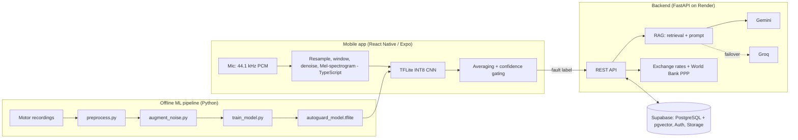
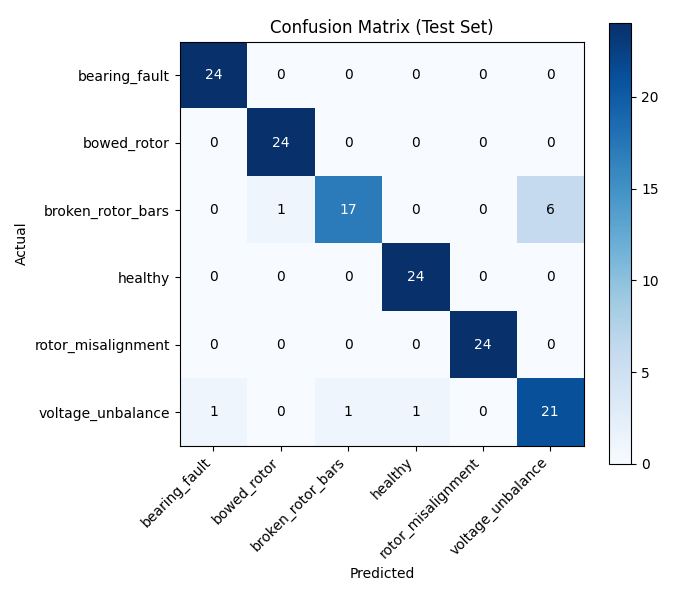
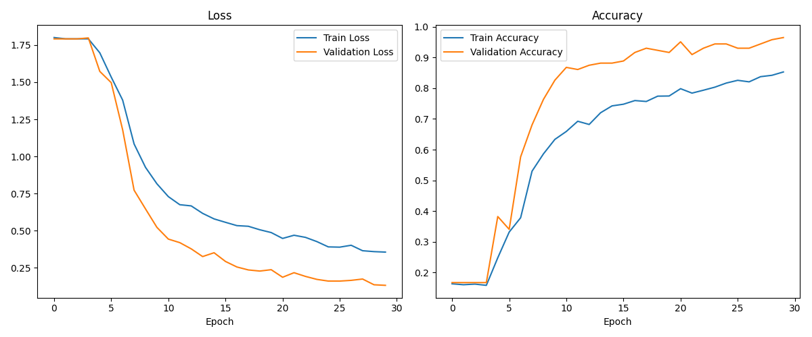

# AutoGuard AI

**Acoustic vehicle-fault diagnosis on your phone: record engine sound, get an on-device deep-learning diagnosis, a plain-language explanation from a RAG chatbot, and a fair repair-price range in your own currency.**

Final Year Project (Year 3) - end-to-end ML product: audio signal processing, CNN training, INT8 quantisation, on-device inference, a retrieval-augmented LLM backend, and a cross-platform mobile app.

> Motivation: in our own survey, **96.7%** of respondents had felt overcharged by a mechanic and **76.7%** found technical explanations confusing. AutoGuard AI aims to give drivers a second opinion *before* they walk into a workshop.

<!-- Add screenshots here: docs/images/dashboard.png, diagnosis.png, chat.png, evaluator.png -->

## What it does

1. **Listen** - records 4 s of raw microphone audio (44.1 kHz PCM).
2. **Diagnose on-device** - resamples, windows, denoises, converts each window to a Mel-spectrogram image and runs a quantised CNN with TensorFlow Lite. No internet needed.
3. **Decide safely** - averages predictions over ~25 windows and applies confidence + window-agreement gating; low-confidence results are shown as "Uncertain Reading - please retake" instead of a confident wrong answer.
4. **Explain** - *Advocacy AI* chatbot grounded in a verified fault knowledge base (RAG: Gemini embeddings + pgvector), with automatic Groq failover and replies generated directly in 6 languages.
5. **Price** - fair repair-cost range, converted with live FX rates and a World Bank PPP price-level ratio so it is realistic for the user's country, not just a relabelled US price.
6. **Remember** - saved diagnoses, chat history, profile, avatar, powertrain, language and currency per user.

## Architecture



## Machine learning

| Item | Detail |
|---|---|
| Task | 6-class acoustic fault classification: healthy, bearing fault, bowed rotor, broken rotor bars, rotor misalignment, voltage unbalance |
| Data | HUSTmotor lab recordings (sound channel, 25.6 kHz); 4 recordings per class at 4 motor speeds. *Add dataset link/citation here.* |
| Features | 4,000-sample windows (~156 ms) -> Mel-spectrogram (n_fft 1024, hop 256, 128 mels) -> 128x128 grayscale image |
| Split | Windows pooled per class, shuffled, 70 / 15 / 15 (train / val / test), fixed seed |
| Augmentation | 2 noisy copies per training image (additive background noise, 0-15 dB SNR), train split only; time-shift and contrast jitter during training |
| Model | CNN: 3x (Conv2D + pooling), Dense(64), Dropout(0.5), Softmax(6); Adam, class weights, early stopping |
| Deployment | Full-integer INT8 post-training quantisation: **39.3 MB (Keras) -> 3.3 MB (TFLite), ~12x smaller** |
| On-device DSP | FFT, Mel filterbank, resampling and spectral-subtraction denoising re-implemented in TypeScript to match the librosa training features |

### Results (held-out test split, 144 windows, 24 per class)

Overall accuracy **0.93** (macro F1 0.93). Weakest classes: broken_rotor_bars (F1 0.81, recall 0.71) and voltage_unbalance (F1 0.82).




Full per-class numbers: [`ai-pipeline/classification_report.txt`](ai-pipeline/classification_report.txt).

### Limitations (please read)

- **Proxy dataset.** Training data are laboratory motor recordings, not real car engines recorded with a phone. Reported accuracy reflects that dataset; field accuracy through a phone microphone is lower and not yet quantified.
- **Optimistic split.** Windows from the same recording can land in both train and test (only 4 recordings per class), so the test score likely overestimates generalisation to unseen recordings.
- **Mitigations in place:** noise augmentation, adaptive spectral subtraction, multi-window averaging and confidence gating.
- **Planned evaluation:** leave-one-recording-out cross-validation and a small set of real phone-recorded clips held out purely for testing.

## Tech stack

**Mobile:** React Native 0.85, React 19, Expo SDK 56, Expo Router, TypeScript, react-native-fast-tflite, react-native-live-audio-stream, EAS Build.
**ML:** Python, TensorFlow/Keras, TensorFlow Lite, librosa, NumPy, SciPy, scikit-learn.
**Backend:** FastAPI, Uvicorn, Pydantic, httpx (async), Supabase (PostgreSQL, pgvector, Auth, Storage), Google Gemini, Groq, deployed on Render.

## Repository structure

```
mobile-app/      React Native / Expo app (screens, audio DSP, on-device inference, i18n)
backend-server/  FastAPI backend (auth, profiles, RAG chatbot, exchange rates, tests)
ai-pipeline/     Data preprocessing, noise augmentation, CNN training, TFLite export
docs/            Images and notes
```

Each folder has its own README with setup instructions.

## Key engineering decisions

- **Raw PCM, not compressed audio**, so the exact training feature pipeline can be reproduced on-device.
- **Confidence gating** over a single prediction: the app prefers "retake" to a confident wrong diagnosis.
- **Template-based opening explanation, LLM only for follow-ups**: the first message after a diagnosis never fails from an AI outage and costs no API call.
- **Chatbot never states prices** (no currency context); it routes to the Price Evaluator.
- **Embeddings model and dimensions are shared** between the indexing script and live queries so vectors stay comparable.
- **Separate Supabase clients** for admin and auth calls to avoid a shared-client session overwriting service-role privileges.

## Testing

- `backend-server/scripts/test_backend_unit.py` - 21 endpoint-level test cases against a running server.
- 29 documented unit-test cases and 3-tester user-acceptance testing in the project report.

## Roadmap

Leave-one-recording-out evaluation, real phone-recorded test set, server-side token verification, forgot-password flow, more fault types and iOS build.

## Author

Oumalkaire Aboubakar  - <oumaabou17@gmail.com / www.linkedin.com/in/oumalkaire-aboubaker >. Licensed under MIT.
